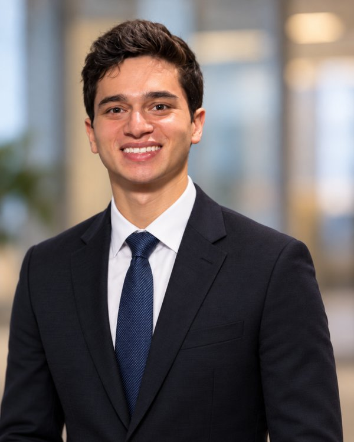

```{=html}
<style>
#title-block-header {
  display: none;
}

</style>

<div class="home-page">
  <section class="home-hero">
    <div class="home-hero-copy">
      <p class="home-hero-kicker">Robotics Ph.D. student · Georgia Tech · Fulbright Specialist</p>
      <h1 class="home-hero-title">Evanns Morales-Cuadrado</h1>
      <p class="home-hero-summary">
        I work on safe autonomy for hardware systems with a focus on uncertainty-aware safe trajectory planning, aggressive low-level control, and lightweight algorithms for computationally constrained platforms. My more recent work has brought me into the worlds of formal methods and deep reinforcement learning for real-world quadrotors.
        As part of my work, I have also had the pleasure of breaking many quadrotors and putting them back together.
      </p>
      <div class="home-icon-links">
        <a href="https://github.com/evannsmc" target="_blank" rel="noopener"><i class="bi bi-github" aria-hidden="true"></i>GitHub</a>
        <a href="https://www.linkedin.com/in/evanns-morales/" target="_blank" rel="noopener"><i class="bi bi-linkedin" aria-hidden="true"></i>LinkedIn</a>
        <a href="https://scholar.google.com/citations?user=kuWXwJsAAAAJ&hl=en&oi=ao" target="_blank" rel="noopener"><i class="bi bi-mortarboard-fill" aria-hidden="true"></i>Google Scholar</a>
        <a href="https://orcid.org/0009-0000-3928-6243" target="_blank" rel="noopener"><svg class="home-orcid" viewBox="0 0 24 24" aria-hidden="true"><circle cx="12" cy="12" r="12" fill="#A6CE39"/><path fill="#fff" d="M7.4 6.6a.9.9 0 1 1 0 1.8.9.9 0 0 1 0-1.8ZM6.7 9.6h1.4v8.2H6.7V9.6Zm3.4 0h3.7c3.5 0 5 2.5 5 4.1 0 1.8-1.4 4.1-5 4.1h-3.7V9.6Zm1.4 1.3v5.6h2.2c3.2 0 3.9-2.4 3.9-2.8 0-1.4-.9-2.8-3.8-2.8h-2.3Z"/></svg>ORCID</a>
        <a href="#" data-u="egm" data-d="gatech.edu" onclick="this.href='mailto:'+this.dataset.u+'@'+this.dataset.d" title="egm [at] gatech [dot] edu"><i class="bi bi-envelope-fill" aria-hidden="true"></i>Email</a>
        <span class="home-icon-meta"><i class="bi bi-geo-alt-fill" aria-hidden="true"></i>Atlanta, GA</span>
      </div>
    </div>
    <figure class="home-hero-portrait">
      
      <figcaption class="home-hero-caption">C'est Moi.</figcaption>
    </figure>
  </section>

  <section class="home-pedigree" id="education" aria-labelledby="education-heading">
    <h2 id="education-heading" class="home-pedigree-heading">Education &amp; honors</h2>
    <div class="home-pedigree-grid">
      <article class="home-pedigree-col">
        <header>
          
          <div><p class="home-pedigree-label">Ph.D. · 2022–present</p><h3>Robotics, Georgia Tech</h3></div>
        </header>
        <p class="home-pedigree-detail">4.0 GPA · Summa Cum Laude · Doctoral minor in Optimization Methods · Deploying novel safe autonomy algorithms on hardware</p>
        <p class="home-pedigree-detail">#2 public ECE program in the U.S.</p>
        <dl class="home-pedigree-people">
          <dt>Advisor</dt>
          <dd><a href="https://scholar.google.com/citations?user=mTf9sk8AAAAJ&hl=en" target="_blank" rel="noopener">Dr. Samuel Coogan</a><span>Eckman Award winner</span></dd>
        </dl>
      </article>
      <article class="home-pedigree-col">
        <header>
          
          <div><p class="home-pedigree-label">Honors B.S.</p><h3>Electrical Engineering, University of Texas</h3></div>
        </header>
        <p class="home-pedigree-detail">Summa Cum Laude · Minors in Math &amp; Physics · Certificate in Unmanned Vehicle Systems</p>
        <dl class="home-pedigree-people">
          <dt>Mentors</dt>
          <dd><a href="https://scholar.google.com/citations?user=rMRit3UAAAAJ" target="_blank" rel="noopener">Dr. Frank Lewis</a><span>World #1 in Optimal Control &amp; Reinforcement Learning · Top 1% cited researcher in the world</span></dd>
          <dd><a href="https://scholar.google.com/citations?user=SwJ_EToAAAAJ&hl=en" target="_blank" rel="noopener">Dr. Yan Wan</a><span>Distinguished Professor · NSF CAREER &amp; IEEE Outstanding Contribution Awards</span></dd>
        </dl>
      </article>
      <article class="home-pedigree-col">
        <header>
          
          <div><p class="home-pedigree-label">Honors</p><h3>Fellowships &amp; recognition</h3></div>
        </header>
        <ul class="home-pedigree-honors">
          <li><a href="https://fulbrightspecialist.worldlearning.org/" target="_blank" rel="noopener"><span class="home-honor-name">Fulbright Specialist</span><span class="home-honor-meta">U.S. Department of State</span><span class="home-honor-cue" aria-hidden="true">↗</span></a></li>
          <li><a href="https://www.nationalmerit.org/" target="_blank" rel="noopener"><span class="home-honor-name">National Merit Scholar</span><span class="home-honor-meta">National Merit Scholarship Corporation</span><span class="home-honor-cue" aria-hidden="true">↗</span></a></li>
          <li><a href="https://bigfuture.collegeboard.org/communities-events/national-recognition-programs" target="_blank" rel="noopener"><span class="home-honor-name">National Hispanic Scholar</span><span class="home-honor-meta">College Board Recognition Program</span><span class="home-honor-cue" aria-hidden="true">↗</span></a></li>
        </ul>
      </article>
    </div>
  </section>
</div>
```


<div class="home-section-heading-row">
  <h2>Inside the Lab</h2>
  <a class="home-text-link" href="./projects/">See my research →</a>
</div>

::: {.home-lab-copy}
I am a Robotics/ECE Ph.D. student in the Formal Methods & Autonomous Control of Transportation Systems ([FACTS](https://coogan.ece.gatech.edu/)) Lab at the Georgia Institute of Technology under the supervision of Dr. Samuel Coogan.

My robotics work centers around hardware applications of safe autonomous control algorithms. In particular, I work on safe and efficient path planning and control synthesis in the face of onboard computational constraints. Much of my work involves hardware demonstrations of novel methods on quadrotor UAVs and unmanned ground vehicles (UGVs). As a result, I've accumulated some cool videos of things flying autonomously and a lot of terrible videos of them crashing.
:::


## My Latest Projects

```{=html}
<div class="home-latest-projects">
<a class="home-latest-project home-latest-project--stacked" href="./projects/lirra/">
  <p class="home-latest-project-title"><code>LIRRA</code></p>
  <div class="home-latest-project-tags" aria-label="LIRRA topic tags">
    <span class="home-latest-project-tag">Runtime Assurance</span>
    <span class="home-latest-project-tag">Signal Temporal Logic</span>
    <span class="home-latest-project-tag">Learning-Based Control</span>
    <span class="home-latest-project-tag">Formal Methods</span>
    <span class="home-latest-project-tag">Safety</span>
    <span class="home-latest-project-tag">Research</span>
  </div>
  <div class="home-latest-project-preview">
    <video autoplay loop muted playsinline aria-label="LIRRA on a Skydio X2 quadrotor: whether the learned plan passed the STL check, a 3D view of the plan in force around the restricted cube, the MuJoCo simulation, and robustness traces over time" loading="lazy">
      <source src="./projects/lirra/x2_phi_plus_composite.mp4" type="video/mp4">
    </video>
  </div>
  <p class="home-latest-project-text">
    LIRRA tackles a core problem in safe autonomy: satisfying complex temporal specifications such as deadlines, restricted regions, and recurring obligations when both the robot's dynamics and the specification's predicates are uncertain, while still pursuing the nominal mission. It does this through runtime assurance: a learned policy pursues the mission by proposing trajectories, and LIRRA certifies each one against the interval signal temporal logic (STL) synthesis constraints before it is flown.

    Only a rejected proposal triggers an expensive mixed-integer solve, delay-compensated so that a verified plan is always in force. Guarantees hold no matter what the network does: on a Skydio X2 quadrotor in MuJoCo, planning is 50&ndash;83x faster and uses 39&ndash;135x less CPU energy than standard MILP-based runtime assurance. Submitted to L4DC 2027.
  </p>
  <span class="home-latest-project-link">Open LIRRA</span>
</a>

<a class="home-latest-project home-latest-project--split" href="./projects/rtd-rax/">
  <p class="home-latest-project-title"><code>RTD-RAX</code></p>
  <div class="home-latest-project-tags" aria-label="RTD-RAX topic tags">
    <span class="home-latest-project-tag">Real-Time Planning</span>
    <span class="home-latest-project-tag">Disturbance Handling</span>
    <span class="home-latest-project-tag">Reachability Analysis</span>
    <span class="home-latest-project-tag">Robotics</span>
    <span class="home-latest-project-tag">Safety</span>
    <span class="home-latest-project-tag">Research</span>
  </div>
  <div class="home-latest-project-row">
    <div class="home-latest-project-preview">
      <video autoplay loop muted playsinline aria-label="RTD-RAX angled obstacles with repair animation" loading="lazy">
        <source src="./projects/rtd-rax/angled_repair_view_two_repairs.mp4" type="video/mp4">
      </video>
    </div>
    <div class="home-latest-project-copy">
      <p class="home-latest-project-text">
        My Runtime-Assurance eXtension (RAX) of the Reachability-based Trajectory Design (RTD) framework for fast candidate trajectory generation paired with an online, disturbance-aware verification layer to produce trajectories that avoid obstacles and achieve mission objectives while facing uncertain dynamics and real-world disturbances.
    
        RTD-RAX extends traditional RTD by separating fast candidate generation from online safety certification. The planner stays agile, while a fast online verifier utilizing Mixed Monotone Reachability (MMR) certifies each trajectory under the actual measured conditions and repairs unsafe candidates before execution. 
      </p>
      <span class="home-latest-project-link">Open RTD-RAX</span>
    </div>
  </div>
</a>
</div>
```


## Beyond the Lab

```{=html}
<div class="home-snapshot">
  <div class="home-snapshot-grid">
    <div class="home-snapshot-card">
      <p class="home-snapshot-kicker">Roots</p>
      <p class="home-snapshot-title">Boricua de pura cepa</p>
      <p class="home-snapshot-copy">
        <!-- Proud of where I'm from and always thinking of ways to connect with my culture. -->
        At Georgia Tech I helped co-found "BORI" to provide a welcoming place for Puerto Rican students and promote our culture across campus.
      </p>
    </div>
    <div class="home-snapshot-card">
      <p class="home-snapshot-kicker">Research</p>
      <p class="home-snapshot-title">When at work</p>
      <p class="home-snapshot-copy">
        From undergraduate research at UT Arlington to my Ph.D. at Georgia Tech. After a summer in Albuquerque, NM at Sandia National Laboratories, I'm continuing there year-round as an AI for Autonomy research intern.
      </p>
    </div>
    <div class="home-snapshot-card">
      <p class="home-snapshot-kicker">Recreation</p>
      <p class="home-snapshot-title">Life</p>
      <p class="home-snapshot-copy">
        I spend whole days outside playing basketball when I'm able to. These days, you can catch me at salsa & bachata socials.
      </p>
    </div>
  </div>
  <div class="home-snapshot-links">
    <a class="home-snapshot-link primary" href="./about/">More About Me</a>
    <a class="home-snapshot-link" href="./journey/">Open Journey Map</a>
  </div>
</div>
```
