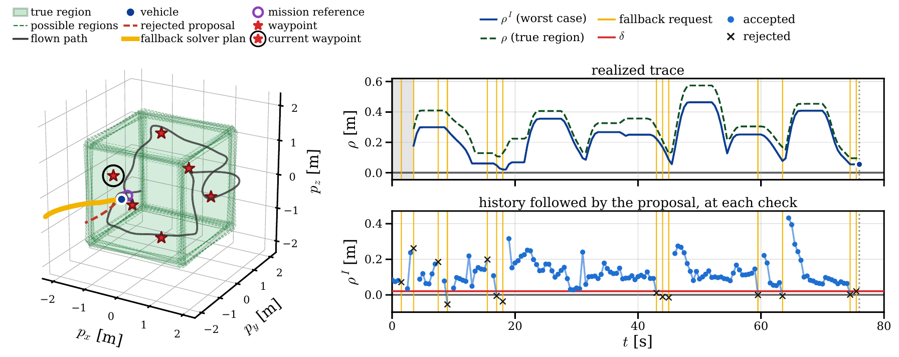

::: {.d-flex .gap-2 .flex-wrap .mb-3}
[L4DC 2027 Paper (Preprint PDF)](../../files/l4dc2027/27_L4DC_LIRRA.pdf){.btn .btn-sm .btn-primary target="_blank"}
[Project Website: Code & Videos](https://evannsmc.github.io/rl-stl/){.btn .btn-sm .btn-outline-primary target="_blank"}
:::

**Skip the Solve: Learning-Accelerated Recursively Feasible Interval-STL for Runtime Assurance**<br>
Evanns Morales-Cuadrado\*, Xinpei Ni\*, Luke Baird, Glen Chou, and Samuel Coogan.
Submitted to the 2027 Learning for Dynamics and Control Conference (L4DC). \**Equal contribution.*

### Showreel

```{=html}
<video controls muted playsinline preload="metadata"
       poster="./lirra_3d_showreel_poster.jpg"
       style="width: 100%; height: auto; border-radius: 0.75rem; border: 1px solid var(--bs-border-color, #dee2e6); background: #fff;"
       aria-label="Showreel of the 3D cube experiments on the Skydio X2 quadrotor and the GT-MAB blimp">
  <source src="./lirra_3d_showreel.mp4" type="video/mp4">
</video>
```

All eight 3D experiments from the paper (6 min): the Skydio X2 quadrotor and the Georgia Tech Miniature Autonomous Blimp (GT-MAB) patrolling around the restricted cube under four specifications, with and without uncertainty in the cube's boundaries, each introduced by a title card. The banner shows whether the latest learned proposal passed the STL check and, if not, which condition it failed while a verified plan flies in the meantime. Left: a 3D view of the cube, the waypoints and the plan in force (blue: accepted proposal, yellow: fallback solver plan, grey: cached plan). Right: the MuJoCo view, the robustness of the realized trace, and the robustness of each proposal against the acceptance threshold. Individual clips are on the [project website](https://evannsmc.github.io/rl-stl/videos.html){target="_blank"}.

### From the paper

```{=html}
<style>
.lirra-figure-card {
  margin: 1.75rem 0 2rem;
  padding: 0.85rem;
  border: 1px solid var(--bs-border-color, #dee2e6);
  border-radius: 1rem;
  background: #fff;
}
.lirra-figure-card img {
  width: 100%;
  height: auto;
  display: block;
  border-radius: 0.75rem;
}
.lirra-figure-card figcaption {
  margin-top: 0.9rem;
  color: #4b5563;
  font-size: 0.95rem;
  line-height: 1.7;
}
</style>
<figure class="lirra-figure-card">
  
  <figcaption>
    LIRRA on the Georgia Tech Miniature Autonomous Blimp with uncertain restricted-region boundaries. After a rejected proposal (dashed red), the vehicle (blue dot) follows the newly synthesized, delay-compensated fallback plan (solid yellow). Right: the realized robustness trace and the robustness of each learned proposal at every check, accepted or rejected.
  </figcaption>
</figure>
```

Long-term robot missions come with temporal requirements such as deadlines, regions to avoid, and recurring obligations, and these must hold despite disturbances and limited onboard computation. My [interval STL runtime assurance](../nahs/) work enforces such specifications under uncertainty in a receding-horizon loop, with terminal constraints that guarantee a feasible continuation always exists. The catch is that it solves a mixed-integer program at every planning step, which is expensive on small robots.

LIRRA (Learning-augmented Interval-STL for Recursively-feasible Runtime Assurance) skips most of those solves. A learned policy proposes a trajectory, and LIRRA checks the proposal against the original synthesis constraints, including the control-invariant terminal conditions. Checking a candidate is far cheaper than finding one. If the proposal fails the check, LIRRA starts a delay-compensated fallback solve and keeps following the last verified trajectory, which already carries a specification-satisfying continuation even if the solver fails or runs late.

**Key ideas:**

- Verify learned trajectory proposals against the exact I-STL synthesis constraints instead of trusting the network
- Fall back to delay-compensated MILP synthesis only when a proposal is rejected
- Always hold a verified, specification-satisfying continuation, so guarantees hold whatever the learned policy does and however long the solver takes
- Recursive feasibility and specification satisfaction under bounded dynamics and predicate uncertainty

**Results** (MuJoCo Menagerie Skydio X2 quadrotor and a custom MuJoCo model of the GT-MAB blimp, compared with standard MILP-based runtime assurance):

| | Skydio X2 | GT-MAB blimp |
|---|---|---|
| Planning steps needing a fallback solve | 0.6–1.3% | 4.1–7.7% |
| Mean computation per planning step | 50–83x faster | 5.3–7.4x faster |
| CPU energy per planning step | 39–135x less | 8.0–13.9x less |

On the X2, the standard method missed seven solver deadlines; LIRRA missed none.

**Academic foundation:**

| Venue | Status |
|---|---|
| 2027 Learning for Dynamics and Control Conference (L4DC) | Submitted |

**Built around:** Runtime assurance · Signal temporal logic · Recursive feasibility · Amortized optimization · Learning-based control
